# HostelHub — Hostel Management System

A multi-organisation hostel management system built with **React 18 (Vite)**, **Node.js / Express 4** and **MySQL 8**.

- An **organisation** (college / institute) owns many **hostels**; every hostel is **male** or **female**.
- A student can **only** be allocated to a hostel of the same gender. This is enforced in the UI (only matching hostels/rooms are offered), in the service layer and inside the allocation transaction (`SELECT … FOR UPDATE`).
- Every list screen has an **All / Male / Female** filter, search and pagination; filters live in the URL.
- All data is scoped to the signed-in user's organisation. `organisation_id` is always taken from the JWT, never from the request body.

---

## Prerequisites

| Tool    | Version |
| ------- | ------- |
| Node.js | 20 or newer (`node -v`) |
| npm     | 9 or newer |
| MySQL   | 8.0.19 or newer, running locally or reachable over the network |

Works on Windows, macOS and Linux. No global packages are required.

## Setup (fresh clone)

```bash
# 1. Configure the backend
cp backend/.env.example backend/.env      # Windows PowerShell: Copy-Item backend/.env.example backend/.env
#    then edit backend/.env: set DB_USER / DB_PASSWORD and two long random JWT secrets

# 2. Install the root tooling (concurrently)
npm install

# 3. Install both apps, create the database, run migrations and seed demo data
npm run setup

# 4. Start API (http://localhost:5000) and web app (http://localhost:5173) together
npm run dev
```

Open **http://localhost:5173** and sign in with one of the demo accounts below.

> `npm run setup` creates the database named in `DB_NAME` (utf8mb4 / utf8mb4_unicode_ci) if it does not exist yet. The MySQL user therefore needs `CREATE` privilege, or create the database yourself first.

Generate a JWT secret with:

```bash
node -e "console.log(require('crypto').randomBytes(48).toString('hex'))"
```

## Environment variables (`backend/.env`)

| Variable | Required | Default | Description |
| --- | --- | --- | --- |
| `NODE_ENV` | no | `development` | `development`, `test` or `production` |
| `PORT` | no | `5000` | API port |
| `CORS_ORIGIN` | no | `http://localhost:5173` | The only origin allowed by CORS |
| `DB_HOST` | yes | — | MySQL host, e.g. `127.0.0.1` |
| `DB_PORT` | no | `3306` | MySQL port |
| `DB_USER` | yes | — | MySQL user |
| `DB_PASSWORD` | yes | — | MySQL password (may be empty: `DB_PASSWORD=`) |
| `DB_NAME` | yes | — | Database name (letters, digits, `_`) |
| `JWT_ACCESS_SECRET` | yes | — | ≥ 32 chars, signs 15-minute access tokens |
| `JWT_REFRESH_SECRET` | yes | — | ≥ 32 chars, different from the access secret, signs 7-day refresh tokens |
| `ACCESS_TOKEN_TTL_MINUTES` | no | `15` | Access token lifetime |
| `REFRESH_TOKEN_TTL_DAYS` | no | `7` | Refresh token lifetime |
| `BCRYPT_ROUNDS` | no | `12` | bcrypt cost factor |

The API validates these with zod on start-up and exits with a readable list of problems if anything is missing or invalid. It also checks that MySQL is reachable and that migrations have been applied, and explains what to do if not (for example *"Cannot reach MySQL at 127.0.0.1:3306 … Is the MySQL 8 server running?"*).

## Scripts

Root (`hostel-management/`):

| Script | What it does |
| --- | --- |
| `npm run dev` | Starts backend (nodemon) and frontend (Vite) together with `concurrently` |
| `npm run setup` | Installs backend + frontend dependencies, creates the DB, runs migrations and seeds |
| `npm run db:reset` | Rolls back every migration, re-runs them and re-seeds the demo data |
| `npm run lint` | ESLint for both apps |
| `npm run format` | Prettier for both apps |
| `npm run build` | Production build of the frontend (`frontend/dist`) |
| `npm start` | Starts the API without nodemon |

Backend (`backend/`): `dev`, `start`, `db:create`, `migrate`, `migrate:rollback`, `seed`, `db:setup`, `db:reset`, `lint`, `lint:fix`, `format`.

Frontend (`frontend/`): `dev`, `build`, `preview`, `lint`, `lint:fix`, `format`.

## Demo logins

Every demo account uses the password **`Password@123`**. The login page has one-click buttons that fill them in.

| Role | Email | Notes |
| --- | --- | --- |
| Super admin | `super@hms.dev` | Manages organisations and org admins |
| Org admin | `admin@git.edu` | Greenfield Institute of Technology (GIT) |
| Org admin | `admin@rce.edu` | Riverside College of Engineering (RCE) |
| Boys hostel manager | `boys.manager@git.edu` / `boys.manager@rce.edu` | Administers all male hostels & male students |
| Girls hostel manager | `girls.manager@git.edu` / `girls.manager@rce.edu` | Administers all female hostels & female students |
| Warden (male) | `warden.male@git.edu` / `warden.male@rce.edu` | Assigned to both male hostels (BH1, BH2) |
| Warden (female) | `warden.female@git.edu` / `warden.female@rce.edu` | Assigned to both female hostels (GH1, GH2) |
| Student (male) | `student01@git.edu` … `student20@git.edu` | 01–14 have a room, 15–20 are unallocated; `student16` has a pending hostel application, `student20` is a first-year who can apply |
| Student (female) | `student21@git.edu` … `student40@git.edu` | 21–34 have a room, 35–40 are unallocated; `student36` has a pending application, `student40` can apply |

The same student pattern exists for RCE (`student01@rce.edu` …).

Seed data per organisation: 1 org admin, 2 wardens, 2 male + 2 female hostels, 10 rooms per hostel (one under maintenance), 40 students (20 male / 20 female) with 28 active allocations and some vacated history, plus complaints, leave requests, notices (all, hostel, floor and year targeted), three days of attendance, mess menus for last, this and next month, two pending hostel applications and outings in every state (pending, approved, out and late, returned).

## Roles

| Role | Can do |
| --- | --- |
| `super_admin` | Create / edit / deactivate organisations, create and (de)activate org admins, platform overview (per-organisation stats, users by role, recent activity), and **read-only platform view** of any organisation's pages via the organisation switcher |
| `org_admin` | Hostels, rooms, wardens (and their hostel assignments), hostel managers (boys/girls), students (incl. CSV import), first-year hostel applications, allocations, mess menu, outings, complaints, leaves, attendance, notices, dashboard — for one organisation |
| `boys_hostel_manager` / `girls_hostel_manager` | Same permissions as `org_admin` (except managing hostel managers), strictly scoped to male (boys) or female (girls) hostels, students, wardens, and operations |
| `warden` | Only their assigned hostels: view residents, mark attendance, approve/reject leaves, approve outings and mark students out / back, handle complaints, set the mess menu, publish notices for their hostels, dashboard |
| `student` | View own room, roommates and wardens, book a hostel (first-year only), see the mess menu, request outings, raise complaints, apply for / cancel leave, read notices, view attendance, edit contact details, change password |

Role-based routing on the frontend (`RoleRoute`), and every API route checks role **and** organisation (`authorize` + organisation-scoped SQL in services).

## API

Base path: **`/api/v1`**

- Success: `{ "success": true, "data": …, "meta": { "page", "limit", "total", "totalPages" } }` (`meta` on lists)
- Error: `{ "success": false, "error": { "code", "message", "details" } }`
- Status codes: `400` validation (field errors in `details`), `401` unauthenticated, `403` wrong role, `404` not found / outside your organisation, `409` business rule conflicts (room full, gender mismatch, duplicates…). Stack traces only in development.
- List endpoints accept `?page=&limit=&search=&gender=male|female&hostelId=&status=&sort=` (`sort=field` or `sort=-field`).

| Endpoint | Methods | Roles |
| --- | --- | --- |
| `/health` | GET | public |
| `/auth/login`, `/auth/refresh`, `/auth/logout` | POST | public (login is rate-limited) |
| `/auth/me` | GET | any signed-in user |
| `/auth/password` | PATCH | any signed-in user |
| `/organisations` (`/:id`, `/:id/admins`, `/:id/admins/:adminId`) | GET, POST, PATCH, DELETE | super_admin |
| `/hostels` (`/:id`) | GET · POST, PATCH, DELETE | org_admin, warden · org_admin |
| `/hostels/:id/rooms` | GET | org_admin, warden |
| `/rooms` (`/:id`) | GET · POST, PATCH, DELETE | org_admin, warden · org_admin |
| `/wardens` (`/:id`, `/:id/hostels`) | GET, POST, PATCH, PUT, DELETE | org_admin, boys_hostel_manager, girls_hostel_manager |
| `/hostel-managers` (`/:id`) | GET, POST, PATCH, DELETE | org_admin |
| `/students` (`/:id`) | GET · POST, PATCH, DELETE | org_admin, warden · org_admin |
| `/students/import` | POST `{ csv, defaultPassword }` | org_admin |
| `/students/me` | GET, PATCH | student |
| `/allocations` (`/:id`) | GET · POST | org_admin, warden · org_admin |
| `/allocations/:id/vacate` | POST | org_admin |
| `/complaints` (`/:id`) | GET · POST · PATCH | all · student · org_admin, warden |
| `/leaves` (`/:id`) | GET · POST · DELETE (cancel pending) | all · student · student |
| `/leaves/:id/review` | POST `{ status, note }` | org_admin, warden |
| `/notices` (`/:id`) | GET · POST, PATCH, DELETE | all · org_admin, warden |
| `/attendance` | GET · POST (bulk upsert) | all · org_admin, warden |
| `/attendance/sheet?hostelId=&date=` | GET | org_admin, warden |
| `/dashboard/summary?gender=` | GET | super_admin, org_admin, warden |
| `/dashboard/platform` | GET | super_admin |
| `/mess?month=YYYY-MM&hostelId=` | GET | all (students always get their own hostel) |
| `/mess/:hostelId/:date` | PUT, DELETE | org_admin, warden (own hostels) |
| `/applications` (`/:id`) | GET · POST | org_admin, student · student (first-year, no room) |
| `/applications/options` | GET | student |
| `/applications/:id/cancel` | POST | student |
| `/applications/:id/review` | POST `{ decision: approved, roomId, startDate }` or `{ decision: rejected, note }` | org_admin |
| `/outings` (`/:id`) | GET · POST | all · student (with a room, up to 24 h) |
| `/outings/:id/review`, `/check-out`, `/check-in` | POST | org_admin, warden |
| `/outings/:id/cancel` | POST | student |

**Platform view.** A super admin may send `X-Organisation-Id: <id>` on any organisation-scoped GET request to see exactly what that organisation's admin sees. Writes with the header are rejected with `403`; the header is ignored for every other role.

**Notices "Send To".** `targetType` is `all`, `hostel` (one hostel), `floor` (one hostel + floors 0–5, 0 = ground) or `year` (years 1–5, optionally one hostel). Optional `startsAt` / `expiresAt` are ISO date-times; students only see notices that are live, match their gender, hostel, floor and year.

### CSV import format

Required columns: `name, email, gender, register_no, department, year`. Optional: `phone, guardian_name, guardian_phone, address, date_of_birth` (`YYYY-MM-DD`). The whole file is validated first (including duplicates inside the file and against the database); rows are inserted in a single transaction only if every row is valid. A template can be downloaded from the import dialog.

## Security

- Passwords hashed with **bcrypt (cost 12)**.
- **Access token (15 min)** and **refresh token (7 days)** are JWTs in **httpOnly, SameSite=Lax** cookies (`Secure` in production). Refresh tokens are stored hashed (SHA-256), rotated on every refresh, and reuse of a rotated token revokes all of that user's sessions.
- The frontend refreshes the access token shortly before it expires, and retries once on a `401`.
- `helmet`, CORS limited to `CORS_ORIGIN`, a general API rate limit, and a stricter **login rate limit** (10 failed attempts / 15 min / IP).
- zod validation of body, query and params on every route. Parameterised SQL only.
- Transactions with row locks for **allocation**, **vacate** and **CSV import** (also leave review, attendance marking and warden assignment).
- Audit log rows for logins, allocations, vacates, imports and other changes.

## Database design

MySQL 8, InnoDB, `utf8mb4_unicode_ci`, snake_case plural tables, `BIGINT UNSIGNED` keys, `created_at` / `updated_at` on every table, explicit and indexed foreign keys with deliberate `ON DELETE` rules. Tables are created only through Knex migrations (`backend/src/db/migrations`, one file per table plus the view; later features are added as new migrations).

Key rules:

- **No duplicated data** — a student's hostel/room comes from their active allocation; room occupancy is computed from active allocations (`v_room_occupancy` view), never stored as a counter. A student's gender lives only in `users.gender`.
- **One active allocation per student** — a stored generated column `active_student_id = IF(status='active', student_id, NULL)` with a `UNIQUE` index.
- `CHECK` constraints: room capacity 1–6, student year 1–5, `to_date >= from_date` for leaves, allocation dates/status consistency, organisation required for every role except super admin.
- `UNIQUE`: organisation name/code, user email, `(organisation_id, code)` for hostels, `(hostel_id, room_number)` for rooms, `(organisation_id, register_no)` for students, `(hostel_id, user_id)` for warden assignments, `(student_id, date)` for attendance.

```mermaid
erDiagram
    organisations ||--o{ users : "employs / enrols"
    organisations ||--o{ hostels : owns
    organisations ||--o{ students : has
    organisations ||--o{ notices : publishes
    organisations ||--o{ audit_logs : records
    users ||--o| students : "profile of"
    users ||--o{ hostel_wardens : "assigned as warden"
    hostels ||--o{ hostel_wardens : "has wardens"
    hostels ||--o{ rooms : contains
    hostels ||--o{ complaints : receives
    hostels ||--o{ attendance : "roll call in"
    hostels ||--o{ notices : "targets (optional)"
    rooms ||--o{ allocations : "beds allocated"
    students ||--o{ allocations : "stays via"
    students ||--o{ complaints : raises
    students ||--o{ leave_requests : "applies for"
    students ||--o{ attendance : "is marked in"
    users ||--o{ allocations : "allocated_by"
    users ||--o{ complaints : "assigned_to"
    users ||--o{ leave_requests : "reviewed_by"
    users ||--o{ attendance : "marked_by"
    users ||--o{ refresh_tokens : owns
    users ||--o{ audit_logs : performs
    hostels ||--o{ mess_menus : serves
    students ||--o{ hostel_applications : "applies (first-year)"
    allocations |o--o| hostel_applications : "created by approval"
    students ||--o{ outing_requests : requests
    hostels ||--o{ outing_requests : "from"
    notices ||--o{ notice_target_values : "targets floors / years"

    organisations {
        bigint id PK
        varchar name UK
        varchar code UK
        varchar address
        varchar contact_email
        varchar contact_phone
        boolean is_active
    }
    users {
        bigint id PK
        bigint organisation_id FK "NULL only for super_admin"
        varchar name
        varchar email UK
        varchar password_hash
        enum role "super_admin|org_admin|warden|student"
        enum gender "male|female"
        varchar phone
        boolean is_active
        timestamp last_login_at
    }
    hostels {
        bigint id PK
        bigint organisation_id FK
        varchar name
        varchar code "UK with organisation_id"
        enum gender "male|female"
        varchar address
        boolean is_active
    }
    hostel_wardens {
        bigint id PK
        bigint hostel_id FK
        bigint user_id FK
    }
    rooms {
        bigint id PK
        bigint hostel_id FK
        varchar room_number "UK with hostel_id"
        smallint floor
        tinyint capacity "CHECK 1-6"
        enum room_type "single|double|triple|quad"
        enum status "active|maintenance"
    }
    students {
        bigint id PK
        bigint user_id FK,UK
        bigint organisation_id FK
        varchar register_no "UK with organisation_id"
        varchar department
        tinyint year "CHECK 1-5"
        varchar guardian_name
        varchar guardian_phone
        varchar address
        date date_of_birth
    }
    allocations {
        bigint id PK
        bigint student_id FK
        bigint room_id FK
        bigint allocated_by FK
        date start_date
        date end_date "NULL = active"
        enum status "active|vacated"
        bigint active_student_id "generated, UK"
    }
    complaints {
        bigint id PK
        bigint student_id FK
        bigint hostel_id FK
        enum category
        varchar title
        text description
        enum priority "low|medium|high"
        enum status "open|in_progress|resolved|closed"
        bigint assigned_to FK
        timestamp resolved_at
    }
    leave_requests {
        bigint id PK
        bigint student_id FK
        date from_date
        date to_date "CHECK >= from_date"
        varchar reason
        enum status "pending|approved|rejected"
        bigint reviewed_by FK
        timestamp reviewed_at
        varchar review_note
    }
    mess_menus {
        bigint id PK
        bigint hostel_id FK
        date date "UK with hostel_id"
        varchar breakfast
        varchar lunch
        varchar snacks
        varchar dinner
        varchar notes
        bigint updated_by FK
    }
    hostel_applications {
        bigint id PK
        bigint student_id FK
        bigint preferred_hostel_id FK
        enum preferred_room_type
        varchar student_note
        enum status "pending|approved|rejected|cancelled"
        bigint reviewed_by FK
        varchar review_note
        bigint allocation_id FK
        bigint pending_student_id "generated, UK"
    }
    outing_requests {
        bigint id PK
        bigint student_id FK
        bigint hostel_id FK
        varchar destination
        varchar reason
        datetime out_at
        datetime expected_return_at "CHECK > out_at"
        enum status "pending|approved|rejected|cancelled|out|returned"
        bigint reviewed_by FK
        datetime checked_out_at
        datetime returned_at
    }
    notice_target_values {
        bigint id PK
        bigint notice_id FK
        tinyint value "floor 0-5 or year 1-5"
    }
    notices {
        bigint id PK
        bigint organisation_id FK
        enum category "general|maintenance|mess|event|academic|emergency"
        enum target_type "all|hostel|floor|year"
        bigint hostel_id FK "for hostel / floor (optional for year)"
        enum audience_gender "all|male|female"
        varchar title
        text body
        boolean is_pinned
        bigint published_by FK
        datetime starts_at
        datetime expires_at
    }
    attendance {
        bigint id PK
        bigint student_id FK
        bigint hostel_id FK
        date date "UK with student_id"
        enum status "present|absent|on_leave"
        bigint marked_by FK
    }
    refresh_tokens {
        bigint id PK
        bigint user_id FK
        varchar token_hash UK
        timestamp expires_at
        timestamp revoked_at
    }
    audit_logs {
        bigint id PK
        bigint organisation_id FK
        bigint user_id FK
        varchar action
        varchar entity
        bigint entity_id
        json meta
    }
```



`v_room_occupancy` (view): `room_id, room_number, floor, room_type, room_status, hostel_id, hostel_name, organisation_id, gender, capacity, occupied, available`.

## Folder structure

```
hostel-management/
├── package.json              # dev / setup / db:reset / lint scripts (concurrently)
├── README.md
├── .gitignore
├── backend/
│   ├── package.json
│   ├── .env.example
│   ├── knexfile.js
│   ├── eslint.config.js, .prettierrc
│   └── src/
│       ├── server.js         # start-up: env + DB health check, graceful shutdown
│       ├── app.js            # express app, security middleware, routes
│       ├── config/           # env.js (zod-validated env), db.js (mysql2 pool + health check)
│       ├── db/
│       │   ├── migrations/   # one file per table + v_room_occupancy view
│       │   ├── seeds/        # demo data
│       │   ├── helpers.js    # shared migration helpers
│       │   └── createDatabase.js
│       ├── modules/          # auth, organisations, hostels, rooms, wardens, students, allocations,
│       │                     # complaints, leaves, notices, attendance, dashboard (+ audit service)
│       │                     # each: routes.js, controller.js, service.js, validation.js
│       ├── middleware/       # authenticate, authorize, validate, errorHandler
│       └── utils/            # AppError, asyncHandler, pagination, schemas, csv
└── frontend/
    ├── package.json, index.html, vite.config.js, tailwind.config.js, postcss.config.js
    ├── eslint.config.js, .prettierrc
    └── src/
        ├── main.jsx, App.jsx
        ├── routes/           # route config, ProtectedRoute, RoleRoute, navigation
        ├── api/              # axios client (cookies + auto refresh) and one file per module
        ├── hooks/            # TanStack Query hooks per module, URL filters, debounce
        ├── context/          # AuthContext
        ├── components/
        │   ├── ui/           # Button, Input, Select, Modal, Table, Badge, Card, StatCard,
        │   │                 # EmptyState, Spinner, Pagination, OccupancyBar
        │   ├── layout/       # AppLayout, Sidebar, Topbar, ChangePasswordModal
        │   └── filters/      # GenderFilter, SearchInput, FilterBar
        ├── lib/              # formatting, validation, constants, form helpers
        ├── pages/            # auth/, super-admin/, admin/, warden/, student/
        └── styles/index.css
```

Controllers only deal with `req` / `res`; all SQL lives in services and uses parameterised queries.

## Notes

- **React Router 6** is used as required. `npm audit` reports two moderate advisories for v6: one only affects server-side rendering (not used here), and one involves redirects to user-supplied paths with backslashes (the only redirect, after login, accepts plain same-app paths only). The fix requires React Router 7.
- npm 11+ asks you to approve dependency install scripts; `bcrypt` (backend) and `esbuild` (frontend) are pre-approved in each `package.json` (`allowScripts`).
